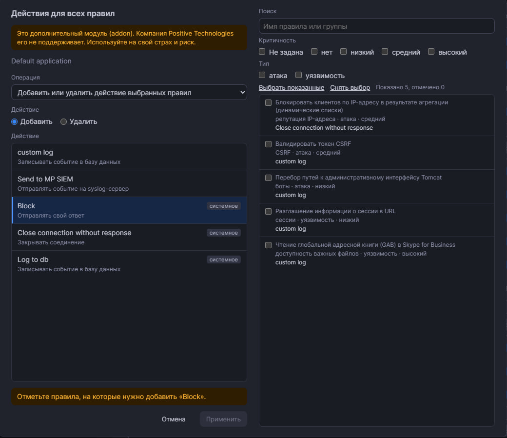
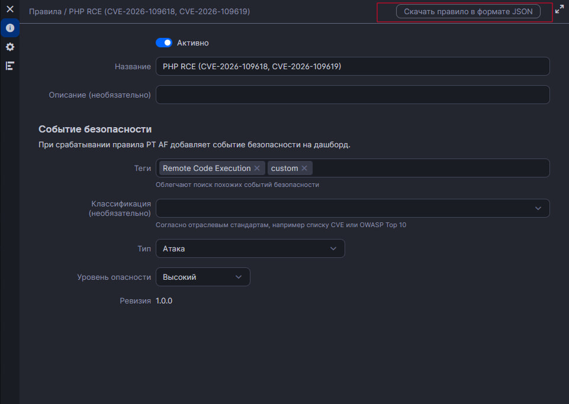
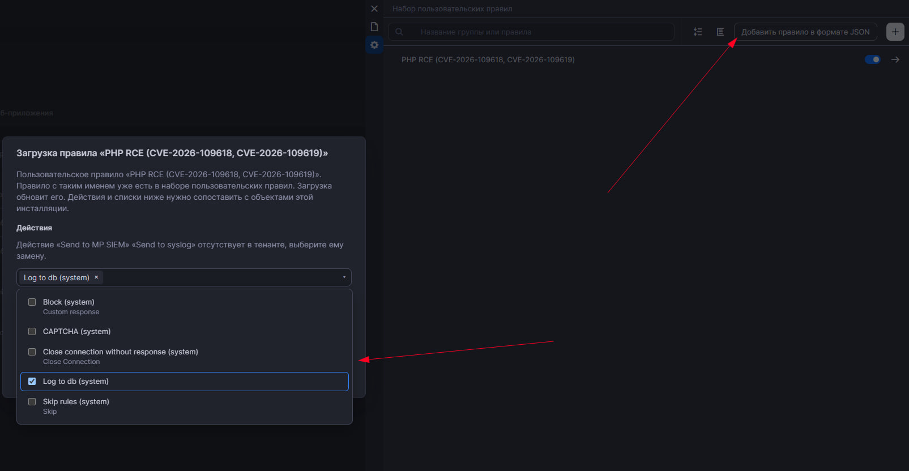
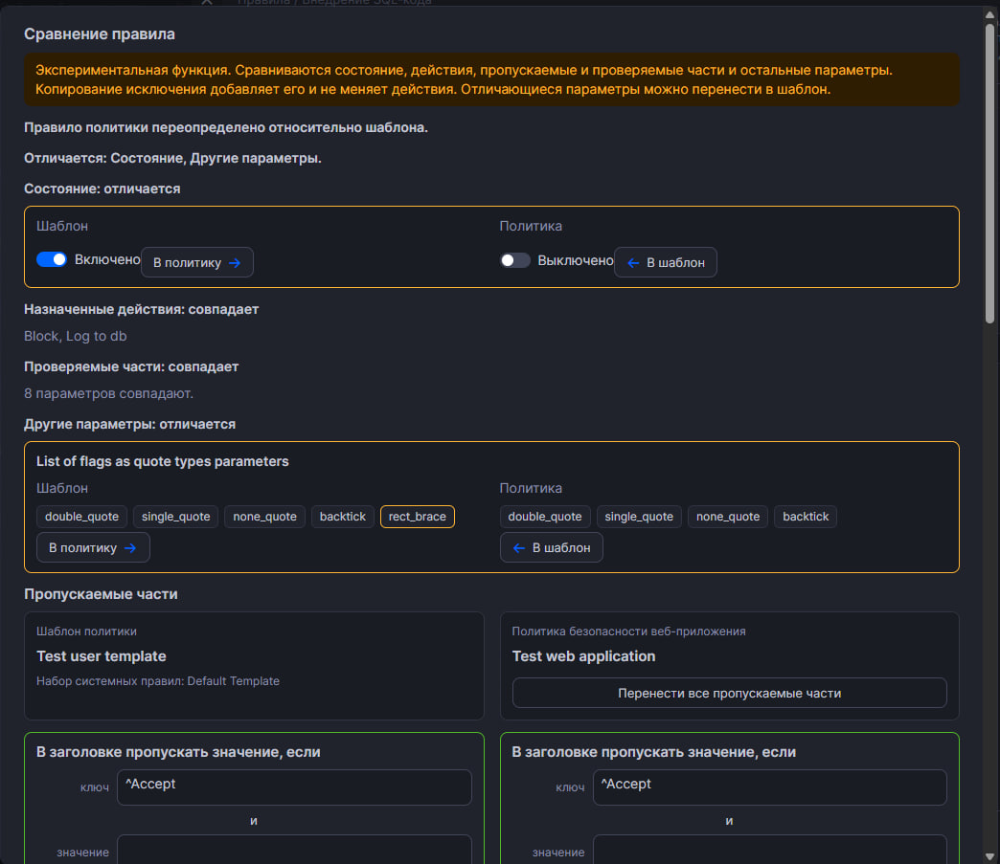
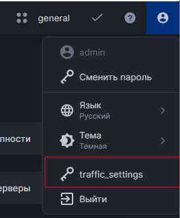
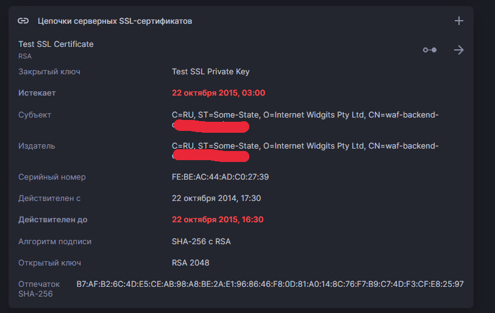

# ptaf-pro-browser-plugin

Это дополнительный модуль (addon). Компания Positive Technologies его не поддерживает. Используйте на свой страх и риск.

Расширение для Chrome работает в уже открытой вкладке PT AF и берёт сессию текущего пользователя. Отдельный логин и пароль не нужны. Адрес стенда не зафиксирован: подойдёт любой `http` или `https`.

- Массовые действия на правилах открытого шаблона политики или политики приложения: кнопка **Действия для всех правил** добавляет или снимает Send to syslog на всех правилах, меняет действие у отмеченных правил или заменяет его.
- Выгрузка и загрузка правила в JSON. При загрузке действия и динамические списки сопоставляются с объектами этой инсталляции.
- Экспериментально: сравнение правила политики и шаблона, пункт **traffic_settings** в меню пользователя.
- Подсветка сертификата, до окончания которого осталось меньше 30 дней, и разбор атрибутов цепочки.

Кнопка есть на страницах правил:

- шаблон политики: `/conf-scheme/user_policy/{id}`
- политика приложения: `/conf-scheme/application_policy/{id}` и `/conf-scheme/policy/{id}`

На системных наборах правил и на user rule set кнопки нет.

## Что понадобится

- Google Chrome или другой браузер на Chromium (Яндекс Браузер, Microsoft Edge).
- Каталог `extension` из этого репозитория. В нём лежат `manifest.json`, папка `content` и папка `icons`.
- Доступ к интерфейсу PT AF и учётная запись с правом менять политики или шаблоны.

## Установка в Chrome

1. Склонируйте репозиторий или скопируйте его каталог на компьютер. Расширение лежит в подпапке `extension`, например `C:\Users\<имя>\Documents\GitHub\ptaf-pro-browser-plugin\extension`.
2. Откройте Chrome и перейдите на страницу `chrome://extensions`.
3. В правом верхнем углу включите **Режим разработчика**.
4. Нажмите **Загрузить распакованное расширение**.
5. В окне выбора папки откройте каталог `extension` и нажмите **Выбор папки**. Корень репозитория и папку `content` выбирать не нужно: в корне лежат служебные файлы, а `content` — только скрипты расширения.
6. В списке расширений появится **PT AF PRO Browser Extension**. У карточки не должно быть красной ошибки. Chrome спросит доступ ко всем сайтам: подтвердите его. Без этого доступа кнопка на адресе стенда не появится.
7. Откройте интерфейс PT AF и войдите под своей учётной записью. Если вкладка уже была открыта до установки, обновите её.
8. Откройте правила шаблона политики или политики приложения. В панели над списком, справа от поля **Group or rule name**, появится кнопка **Действия для всех правил**.

В Microsoft Edge те же шаги выполняются на странице `edge://extensions`. В Яндекс Браузере — на `browser://extensions`.

## Как пользоваться

1. Откройте нужный шаблон или политику приложения на странице правил.
2. Нажмите **Действия для всех правил**.
3. В поле **Операция** выберите, что сделать.
4. Выберите действие в списке. На первой строке имя, под ним описание типа. У системного действия справа стоит пометка **системное**.
5. Прочитайте жёлтую строку: в ней написано, что именно изменится и у какой политики или шаблона.
6. Нажмите **Применить**. После успешного запроса внизу справа появится уведомление.

Пункты **Добавить Send to syslog** и **Удалить Send to syslog** затрагивают все правила открытой сущности. Пункт **Добавить или удалить действие выбранных правил** и три замены меняют только отмеченные правила.

### Добавить или удалить Send to syslog

В списке только действия типа Send to syslog.

- **Добавить Send to syslog** ставит выбранное действие на правила, где уже есть Log to DB. Без Log to DB Send to syslog не работает, и на такие правила он не ставится.
- **Удалить Send to syslog** снимает его со всех правил одним запросом.

Снять добавленное действие со всех правил можно повторным запуском с операцией **Удалить Send to syslog**.

### Добавить или удалить действие выбранных правил

Это отдельная операция в выпадающем списке **Операция**. Слева под ней переключатель **Добавить** / **Удалить** и список действий типов Log to DB, Custom response, Send TCP RST и Send to syslog. Справа поиск, наборы **Критичность** и **Тип** и список правил с галочками. Жёлтая строка внизу слева называет выбранное действие. Кнопка **Применить** неактивна, пока не отмечено ни одно правило.

В список попадают только правила, у которых уже есть хотя бы одно действие. Запись без действий не считается правилом и не показывается. Не показываются правила типа **Информация** и правила на фазах WebSocket и ICAP. Пока список читается, в окне виден прогресс.

Поиск и список правил стоят справа, на всю высоту окна. Слева остаются операция, список действий и кнопки. Имена правил и групп берутся из тех же файлов локализации, что и список правил PT AF: имя по идентификатору правила, группа по её ключу. Подписи типа и критичности тоже из языка интерфейса, например «атака» и «низкий». Поиск сравнивает запрос с показанным именем и с исходным. Наборы **Критичность** и **Тип** оставляют только отмеченные значения; если в наборе ничего не отмечено, по этому признаку показываются все. Под именем правила видны тип, критичность и действия, которые на нём уже стоят. Скрытое фильтром правило не теряет галочку. **Выбрать показанные** отмечает то, что сейчас видно. **Снять выбор** снимает все галочки.

Пустой выбор операцию не запускает: **Применить** остаётся неактивной. Применяются только отмеченные правила. В одном правиле может быть только один Log to DB, только один Custom response и только один Send TCP RST. Custom response и Send TCP RST вместе стоять не могут. При добавлении Log to DB справа остаются только правила, где его ещё нет. При добавлении Custom response, в том числе Block, и при добавлении Send TCP RST остаются только правила, где нет ни Custom response, ни Send TCP RST. При удалении остаются только правила, на которых выбранное действие уже стоит. При добавлении syslog остаются только правила, где Log to DB уже есть: без него Send to syslog не работает. В итоге показано, сколько правил изменено, сколько пропущено и сколько не удалось изменить.

### Заменить действие

Замена идёт в том же окне, что и выбор правил. Справа поиск, критичность, тип и список с галочками. Слева действие, которое встанет вместо текущего. Переключателя **Добавить** / **Удалить** в замене нет. Меняются только отмеченные правила.

- **Заменить Log to DB** показывает правила, на которых уже есть Log to DB, и ставит выбранный Log to DB вместо прежнего. Другой Log to DB на правиле не остаётся.
- **Заменить Custom response** показывает правила с Custom response. Выбранный ответ заменяет прежний Custom response и снимает Send TCP RST, если он был.
- **Заменить Send RST на Custom response** показывает правила с Send TCP RST. Выбранный Custom response заменяет Send TCP RST и снимает прежний Custom response, если он был.

Пока замена идёт, в окне виден номер проверяемого правила и сколько правил уже изменено. Если часть правил не обновилась, окно остаётся открытым и показывает, сколько правил не удалось изменить.

### Выгрузка и загрузка правила

В открытом наборе пользовательских правил, в строке поиска слева от кнопки создания правила, есть **Добавить правило в формате JSON**. На шаблоне политики и на политике этой кнопки нет. Если список набора пустой и строки поиска нет, кнопка стоит в шапке набора справа от названия. В шапке открытого пользовательского правила, справа от его имени, есть **Скачать правило в формате JSON**. На списке набора кнопки скачивания нет.

**Выгрузить JSON** сохраняет пользовательское правило: имя, описание, событие, код, параметры, действия и агрегация. В файл записываются имена действий, динамических списков и классификаторов, на которые правило ссылается. Системное правило выгрузить нельзя.

**Загрузить JSON** открывает окно **Загрузка правила** и читает файл пользовательского правила на другой инсталляции. Файл системного правила не принимается. Кнопка **Добавить правило в формате JSON** в строке поиска набора запускает эту загрузку. Найденные действия подставляются чипами, как в назначении действий правила. Поле открывает список действий тенанта с галочками: отмеченные попадут в правило, снятые — нет. Если действия из файла нет в тенанте, под полем написано его имя и тип. Динамические списки и классификаторы по-прежнему нужно сопоставить. Если идентификатор совпал, выбирается он. Если идентификатор другой, но имя одно, оно подставляется само. Новые действия и списки расширение не создаёт.

Пользовательское правило записывается в набор пользовательских правил этого тенанта. Набор в тенанте один, выбирать его не нужно. Правило с тем же именем обновляется. После записи страница обновляется и набор открывается снова, чтобы правило сразу появилось в списке.

### Сравнение политики и шаблона

Это экспериментальная функция. Она выключена, пока в настройках расширения не отмечена галка **Экспериментальные функции**. Настройки открываются щелчком по значку расширения или со страницы `chrome://extensions`: карточка расширения, **Подробнее**, **Параметры расширения**.

После включения на странице одного правила политики или шаблона, в том числе на вкладке исключений, появляется кнопка **Сравнить с шаблоном** или **Сравнить с политикой**. Рядом пометка **эксперимент**. Кнопка стоит в карточке правила, сразу под блоком переопределения. Если этого блока нет, она стоит в начале карточки. В меню пользователя над **Выйти** появляется пункт **traffic_settings**. Снятие галки убирает их с открытой вкладки.

Сверху окно пишет, чем правило отличается: состояние включено или выключено, назначенные действия, пропускаемые части, проверяемые части и остальные параметры. Раздел, которого у правила нет, не показывается. Состояние и параметры стоят блоками в двух столбцах **Шаблон** и **Политика**, у каждого значения кнопка переноса. Отличающееся обведено оранжевой рамкой. Совпавшие пропускаемые части стоят друг напротив друга в зелёной рамке. Внизу блока пропускаемых частей кнопка **Перенести все пропускаемые части**. Одинаковые исключения тоже стоят друг напротив друга и отмечены зелёной рамкой, исключения только с одной стороны — жёлтой. Флаг переопределения показывается отдельно: правило может быть переопределено, даже если значения уже совпали. Если у шаблона нет политики веб-приложения, сравнение идёт с набором системных правил. Пропускаемые части (где указано, что пропускать: ключ или значение) сравниваются только с пропускаемыми частями. Исключения, например по IP, сравниваются только с исключениями. Настройки вроде аутентификации остаются параметрами правила. Ниже исключения. Слева шаблон политики и набор системных правил, на котором он создан. Справа политика безопасности веб-приложения. Если политики нет, слева набор правил, справа шаблон. Под исключением шаблона кнопка переносит его в политику. Под исключением политики кнопка со стрелкой копирует его в шаблон, там же кнопка переносит все исключения политики в шаблон. Перенос добавляет исключение к уже существующим и не затирает их. Совпадающие исключения не дублируются. Запись начинается после жёлтого подтверждения. Если правило политики совпадает с шаблоном, но наследуемость нарушена, окно предлагает её восстановить. 

### traffic_settings

Это экспериментальная функция. Она выключена, пока в настройках расширения не отмечена галка **Экспериментальные функции**.

После включения откройте меню пользователя в правом верхнем углу. Пункт **traffic_settings** стоит над **Выйти** (в английском интерфейсе — над **Log out**).

Окно читает и сохраняет параметры обработки трафика текущего изолированного пространства, те же, что меняет утилита `traffic_settings.py`: число веб-приложений, заголовок Host, буферы, таймауты, журналы и уровень логирования nginx и Envoy. В списке только параметры, которые стенд уже отдаёт. Изменяются все веб-приложения этого пространства. Сохраняются только поля, которые вы поменяли. На версии 4.5.2 и выше параметры журналов access.log и error.log, а также уровни логирования nginx и Envoy, изменить нельзя.

### Срок действия сертификата

В цепочке сертификатов строка с датой окончания подсвечивается красным, если до неё осталось меньше 30 дней. Срок берётся из поля `not_valid_after` (Unix-время) в ответе API. Уже истёкший сертификат тоже подсвечивается. Дата вроде 21 января 2028 года остаётся обычного цвета.

В раскрытых сведениях цепочки красным подсвечены поля **Истекает** и **Действителен до**. Под полем сертификата и в этих сведениях расширение разбирает PEM и показывает атрибуты каждого сертификата: субъект, издатель, серийный номер, срок, алгоритм, ключ, дополнительные имена и отпечаток SHA-256. Содержимое закрытого ключа не показывается.

## Обновление

После изменений в файлах расширения откройте `chrome://extensions` и на карточке **PT AF PRO Browser Extension** нажмите кнопку обновления. Затем обновите вкладку PT AF.

## Удаление

На странице `chrome://extensions` у карточки **PT AF PRO Browser Extension** нажмите **Удалить**.

## Если кнопка не появилась

- Открыта страница правил шаблона или политики приложения. На схеме конфигурации, в событиях безопасности и в системных наборах правил кнопки нет.
- Вкладка PT AF обновлена после установки или после обновления расширения.
- На `chrome://extensions` у расширения нет ошибок, и для него разрешён доступ к сайту.
- Пользователь вошёл в PT AF. Если сессия истекла, окно попросит обновить страницу и войти снова.

